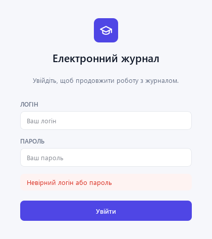
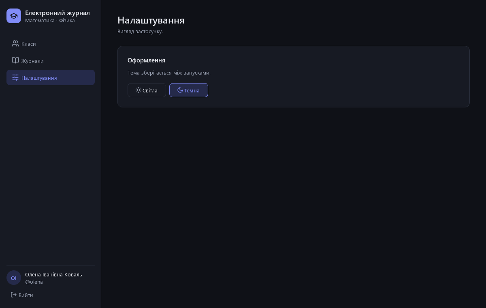

# Електронний журнал викладача

Приватний десктопний журнал для викладачки математики і фізики (середні та старші класи):
класи з учнів, журнали по предметах, відвідування та 12-бальні оцінки, експорт для перенесення
в шкільний електронний журнал.

Дипломний пет-проєкт.

## Скриншоти

| Вхід | Головне вікно |
|---|---|
|  |  |
|  |  |

## Стек

- Python
- PySide6 (Qt) — інтерфейс
- PostgreSQL + SQLAlchemy 2 + Alembic — база даних
- pytest — тести
- PyInstaller + Inno Setup — збірка в один інсталятор (пізніше)

## Архітектура

Три шари: **інтерфейс → сервіси → репозиторії (БД)**. Інтерфейс не знає про таблиці й запити:
він лише відкриває транзакцію (`session_scope()`) і викликає сервіси. Тому інтерфейс можна
замінити (наприклад, на веб) без переписування логіки.

```
src/journal/
  ui/            # вікна PySide6
  services/      # бізнес-логіка
  repositories/  # доступ до БД
  models/        # таблиці SQLAlchemy
tests/
```

## Модель даних

Викладач → Клас (учні) → Журнал (клас + предмет на навчальний рік) → Уроки (з семестром) → Записи (учень × урок:
відвідування, оцінка 1–12, коментар).

## Дані й приватність

Реальні дані учнів **ніколи** не комітяться. Файли `.env`, дампи БД та папка `data/` у `.gitignore`.

## Запуск (розробка)

1. Встановити PostgreSQL 17 і Python 3.12+.
2. Від імені адміністратора: `powershell -ExecutionPolicy Bypass -File scripts\setup_dev_db.ps1`
   Скрипт питає пароль суперкористувача `postgres`, створює (або оновлює) користувача `journal_user`,
   бази `journal` і `journal_test` (окрема база для тестів) та записує файл `.env`.
   Можна запускати повторно. Якщо пароль `postgres` невідомий — додайте ключ `-ResetSuperuserPassword`:
   скрипт **змінить пароль `postgres`** і двічі перезапустить службу PostgreSQL
   (це вплине на інші локальні проєкти, які використовують цей сервер).
3. Віртуальне середовище й залежності (точні версії — у `requirements.lock.txt`):
   ```
   python -m venv .venv
   .venv\Scripts\python -m pip install -r requirements.lock.txt
   ```
4. Створити таблиці: `.venv\Scripts\alembic upgrade head`
5. Запуск застосунку: `.venv\Scripts\python run.py`
   (при першому запуску відкриється створення облікового запису викладача).
6. Тести: `.venv\Scripts\python -m pytest -q`
   (працюють лише з базою з `TEST_DATABASE_URL` і самі застосовують до неї міграції).

Тести автоматично запускаються на GitHub (GitHub Actions, Windows + PostgreSQL) для кожного PR.
Журнал роботи застосунку: `%LOCALAPPDATA%\teacher-journal\logs\journal.log` (без паролів та імен учнів).

## Схема БД

| Таблиця | Призначення |
|---|---|
| `teachers` | викладачі (логін, хеш пароля) |
| `classes` | класи викладача на навчальний рік |
| `students` | учні класу з порядковим номером |
| `subjects` | довідник предметів |
| `journals` | журнал = клас + предмет |
| `lessons` | уроки журналу (дата, семестр, тема, тип) |
| `lesson_entries` | учень × урок: відвідування, оцінка 1–12, коментар |
| `final_grades` | семестрові й річні оцінки |

Обмеження (оцінка 1–12, семестр 1/2, унікальність записів) перевіряються на рівні PostgreSQL.
