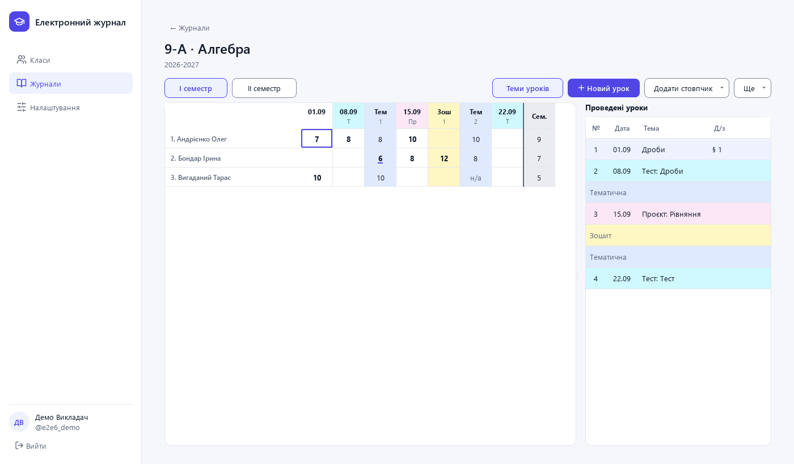
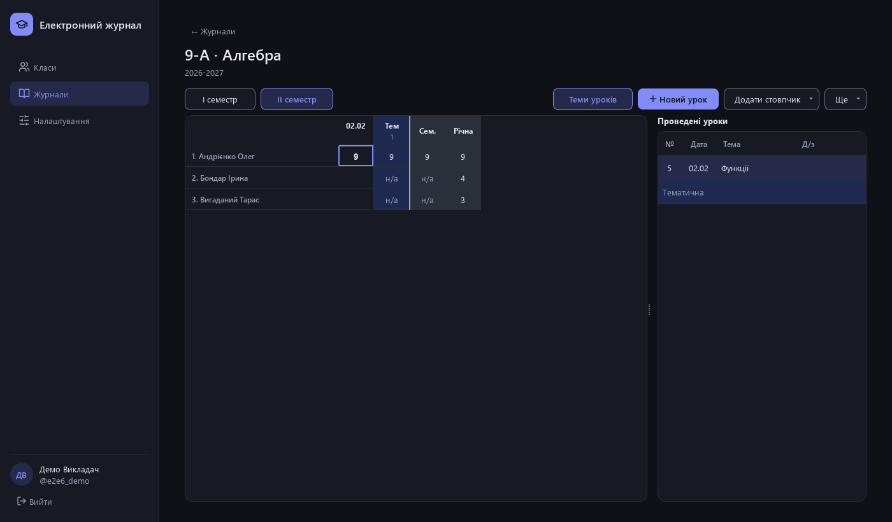
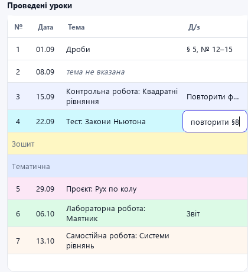

# Електронний журнал викладача (teacher-journal)

*English: a private desktop gradebook for a secondary-school math and physics teacher, built as a diploma project.
Python + PySide6 UI, PostgreSQL via SQLAlchemy 2 and Alembic, layered architecture (ui, services, repositories),
keyboard-driven grade entry, and a pilot per-user Windows installer with an embedded PostgreSQL (no admin rights needed).
The UI is in Ukrainian. Development was assisted by AI coding tools under the author's supervision.*

Приватний десктопний електронний журнал для викладачки математики і фізики: класи, учні,
журнали з оцінками та відвідуванням, семестрові й річні підсумки.

> Усі дані на скриншотах — демонстраційні. Реальні дані учнів у репозиторій не потрапляють.

## Що вміє

- Класи й учні (за українським алфавітом), архів класів, автоматичний перехід на новий навчальний рік.
- Журнали «клас + предмет» з таблицею оцінок і введенням з клавіатури: цифри — оцінка (1–12),
  `н` — відсутній, `х` — хворів, `з` — запізнився, `Del` — очистити, `Enter`/`Tab` — навігація, `F2` — коментар.
- Семестри за місяцями (за замовчуванням вер–гру → I, січ–чер → II; налаштовується), наскрізна нумерація уроків за рік.
- Тематичні, семестрові та річні оцінки: правило «н/а», округлення 7,5 → 8, ручна зміна.
- «Зошит» і домашнє завдання до уроків.
- Світла й темна теми.
- Інсталятор без прав адміністратора з вбудованим PostgreSQL (пілотна версія).
- Експорт в Excel для перенесення в шкільний журнал — **в розробці**.
- Резервні копії з програми (pg_dump, відновлення) — **в розробці**.

## Скриншоти

| Журнал, світла тема | Оцінки підсумку, темна тема |
|---|---|
|  |  |

| Вхід | Панель «Проведені уроки» з д/з |
|---|---|
|  |  |

## Технології

- Python 3.12+, PySide6 (Qt) — інтерфейс
- PostgreSQL 17, SQLAlchemy 2, Alembic — база даних і міграції
- Argon2 — хешування паролів
- pytest, pytest-qt — тести
- PyInstaller + Inno Setup — збірка інсталятора
- GitHub Actions — CI (Windows + PostgreSQL) для кожного PR

## Архітектура

Три шари: інтерфейс → сервіси → репозиторії. Інтерфейс не імпортує SQLAlchemy, моделі чи
репозиторії; його єдиний дотик до БД — `journal.db.session_scope()`, що відкриває транзакцію
навколо виклику сервісу. Сервіси отримують `Session` ззовні. Схема БД змінюється лише через міграції Alembic.

```
 ui (PySide6)  -->  services  -->  repositories  -->  PostgreSQL
      |                                                   ^
      +----------- session_scope() (транзакція) ----------+
```

```
src/journal/
  ui/            # вікна PySide6, тема (кольори лише через токени)
  services/      # бізнес-логіка
  repositories/  # доступ до БД
  models/        # таблиці SQLAlchemy
tests/
```

Модель даних: викладач → клас (учні) → журнал (клас + предмет на навчальний рік) → уроки →
записи (учень × урок: відвідування, оцінка 1–12, коментар) та підсумкові оцінки. Обмеження
(оцінка 1–12, семестр 1/2, унікальність записів) перевіряються на рівні PostgreSQL.

## Запуск для розробника

1. Встановити PostgreSQL 17 і Python 3.12+.
2. Від імені адміністратора: `powershell -ExecutionPolicy Bypass -File scripts\setup_dev_db.ps1`
   Скрипт питає пароль суперкористувача `postgres`, створює (або оновлює) користувача `journal_user`,
   бази `journal` і `journal_test` (окрема база для тестів) та записує файл `.env`.
   Можна запускати повторно. Якщо пароль `postgres` невідомий — додайте ключ `-ResetSuperuserPassword`:
   скрипт **змінить пароль `postgres`** і двічі перезапустить службу PostgreSQL
   (це вплине на інші локальні проєкти, які використовують цей сервер).
3. Віртуальне середовище й залежності (точні версії — у `requirements.lock.txt`):
   ```
   python -m venv .venv
   .venv\Scripts\python -m pip install -r requirements.lock.txt
   ```
4. Створити таблиці (міграції): `.venv\Scripts\alembic upgrade head`
5. Запуск застосунку: `.venv\Scripts\python run.py`
   (при першому запуску відкриється створення облікового запису викладача).

Журнал роботи застосунку: `%LOCALAPPDATA%\teacher-journal\logs\journal.log` (без паролів та імен учнів).

## Тести

```
.venv\Scripts\python -m pytest -q
```

Тести працюють лише з окремою базою `journal_test` (`TEST_DATABASE_URL`), самі застосовують до неї
міграції й виконуються в транзакції з відкатом. На GitHub вони запускаються автоматично для кожного PR.

## Збірка інсталятора

`powershell -File packaging\build.ps1` — збирає застосунок через PyInstaller і пакує його
в інсталятор Inno Setup (встановлення для поточного користувача, без прав адміністратора).
PostgreSQL вбудований: запускається самим застосунком у `%LOCALAPPDATA%`, слухає лише `127.0.0.1`
з випадковим паролем. Конфігурація — у папці `packaging/`.
Відновлювати можна лише копії, створені цією програмою: файл `.dump` виконується від імені користувача бази застосунку.
Потрібні: PyInstaller, PostgreSQL 17 (`C:\Program Files\PostgreSQL\17` або ключ `-PgSource`) та Inno Setup 6
(без нього крок інсталятора пропускається).

## Якщо викладачка забула пароль

1. **Код відновлення.** Він показується один раз після створення облікового запису, після кожної зміни
   пароля, а для облікового запису без коду — при першому вході. На вході натисніть «Забули пароль?», введіть логін, код і новий пароль — програма покаже новий код.
2. **Якщо код загублено** — автор скидає пароль локально на комп'ютері викладачки (журнал має бути закритий):
   - режим розробки: `.venv\Scripts\python scripts
eset_password.py <логін>` (потрібен `.env`);
   - встановлена версія: `set JOURNAL_EMBEDDED=1`, потім `python scripts
eset_password.py <логін>`
     (скрипт сам запустить вбудований PostgreSQL).

   Пароль скрипт питає двічі через `getpass` і не приймає його аргументом. Він знімає блокування й друкує
   новий код відновлення.

Після 5 невдалих входів поспіль вхід блокується на 30 с; далі пауза подвоюється, максимум 15 хв.

## Статус

Дипломний проєкт, у розробці. Готово: класи й учні, журнали, підсумкові оцінки, «Зошит», д/з,
теми, пілотний інсталятор. Далі: резервні копії, зміна пароля й захист від підбору, експорт в Excel,
завершення інсталятора.

## Про використання ШІ

Код написано з допомогою ШІ-асистентів (Claude Code) під керівництвом і контролем автора:
рішення щодо продукту й архітектури ухвалюються з автором, кожна зміна проходить через
окрему гілку, pull request, автоматичні тести й рецензію.

## Дані й приватність

Реальні дані учнів, файли `.env` і дампи БД ніколи не комітяться (див. `.gitignore`).
Паролі зберігаються лише як хеш Argon2.

Усі права застережено.
