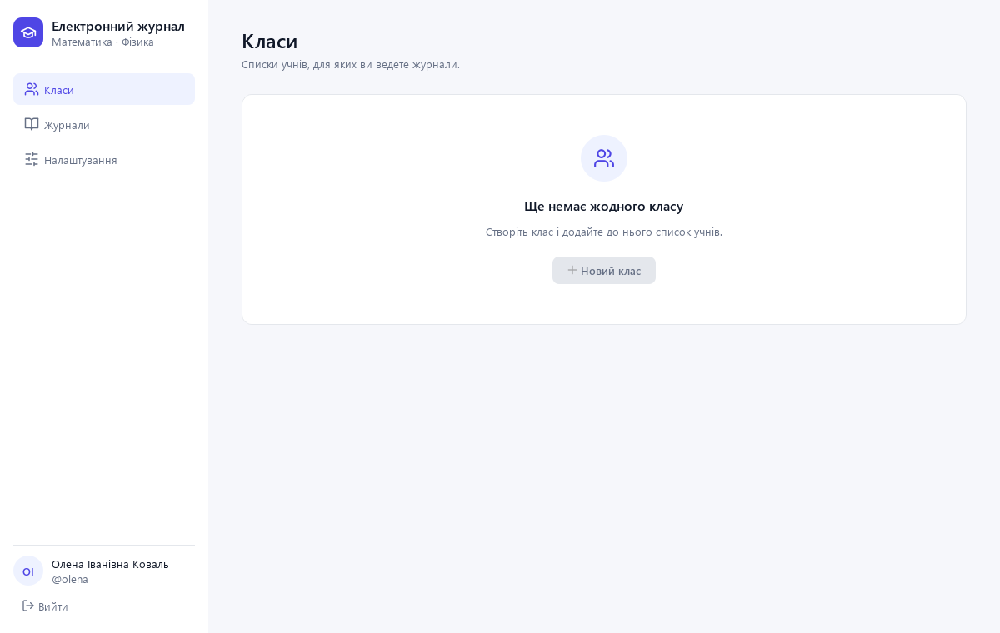
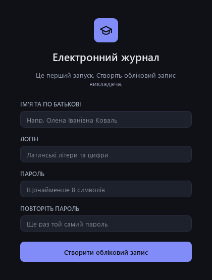

# Електронний журнал викладача

Приватний десктопний журнал для викладачки математики і фізики (середні та старші класи):
класи з учнів, журнали по предметах, відвідування та 12-бальні оцінки, експорт для перенесення
в шкільний електронний журнал.

Дипломний пет-проєкт.

## Скриншоти

| Вхід | Головне вікно |
|---|---|
|  |  |
|  |  |

## Стек

- Python
- PySide6 (Qt) — інтерфейс
- PostgreSQL + SQLAlchemy 2 + Alembic — база даних
- pytest — тести
- PyInstaller + Inno Setup — збірка в один інсталятор (пізніше)

## Архітектура

Три шари: **інтерфейс → сервіси → репозиторії (БД)**. Інтерфейс не знає про БД,
тому його можна замінити (наприклад, на веб) без переписування логіки.

```
src/journal/
  ui/            # вікна PySide6
  services/      # бізнес-логіка
  repositories/  # доступ до БД
  models/        # таблиці SQLAlchemy
tests/
```

## Модель даних

Викладач → Клас (учні) → Журнал (клас + предмет + семестр) → Уроки → Записи (учень × урок:
відвідування, оцінка 1–12, коментар).

## Дані й приватність

Реальні дані учнів **ніколи** не комітяться. Файли `.env`, дампи БД та папка `data/` у `.gitignore`.

## Запуск (розробка)

1. Встановити PostgreSQL 17 і Python 3.12+.
2. Від імені адміністратора: `powershell -ExecutionPolicy Bypass -File scripts\setup_dev_db.ps1`
   (створює БД `journal`, користувача `journal_user` і файл `.env`).
3. Віртуальне середовище й залежності:
   ```
   python -m venv .venv
   .venv\Scripts\python -m pip install -r requirements.txt
   ```
4. Створити таблиці: `.venv\Scripts\alembic upgrade head`
5. Запуск застосунку: `.venv\Scripts\python run.py`
   (при першому запуску відкриється створення облікового запису викладача).
6. Тести: `.venv\Scripts\python -m pytest -q`

## Схема БД

| Таблиця | Призначення |
|---|---|
| `teachers` | викладачі (логін, хеш пароля) |
| `classes` | класи викладача на навчальний рік |
| `students` | учні класу з порядковим номером |
| `subjects` | довідник предметів |
| `journals` | журнал = клас + предмет |
| `lessons` | уроки журналу (дата, семестр, тема, тип) |
| `lesson_entries` | учень × урок: відвідування, оцінка 1–12, коментар |
| `final_grades` | семестрові й річні оцінки |

Обмеження (оцінка 1–12, семестр 1/2, унікальність записів) перевіряються на рівні PostgreSQL.
